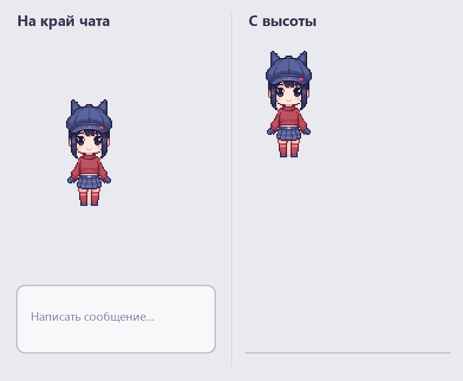

# mita-claude

Для юзеров Claude: пиксельная Мита из MiSide в десктопе, с физикой и анимациями.

Она живёт поверх окна **Claude Desktop** или приложения **Codex** или **ChatGPT** (того, что сейчас активно):
гуляет по низу окна, оглядывается, а если её уронить или швырнуть — эпично шлёпается, лежит со звёздочками, встаёт и отряхивается.
Её можно брать мышкой и швырять. Само приложение Claude/Codex не меняется,
так что после обновлений ничего не слетает.

При мягком приземлении Мита приседает, а после сильного падения поднимается с колен.

## Что нужно

- Windows 10/11 или macOS
- [Python 3](https://www.python.org/downloads/) (бесплатно). При установке поставь галочку **Add Python to PATH**.
  Больше ничего ставить не надо: tkinter уже входит в Python.

## Как запустить

1. Скачай репозиторий: зелёная кнопка **Code → Download ZIP**, распакуй куда угодно.
2. Открой Claude или Codex.
3. Дважды кликни **start.bat**.

Чтобы Мита запускалась сама вместе с Windows, один раз запусти **autostart.bat**.
Убрать из автозагрузки: `Win+R` → `shell:startup` → удалить `mita-claude.vbs`.

## macOS (бета)

1. Поставь Python 3 с [python.org](https://www.python.org/downloads/) (там уже есть tkinter).
2. Скачай репозиторий (**Code → Download ZIP**) и распакуй.
3. Дважды кликни **start_mac.command**. В первый раз он сам поставит бесплатный `pyobjc`.
   Если мак пишет **«Not Opened / Apple could not verify…»** (так он делает со всеми скачанными
   скриптами без подписи Apple), нажми **Done** и выбери один из способов:
   - **Через Терминал (проще всего):** открой Терминал, впиши `bash ` (с пробелом),
     перетащи в окно Терминала файл `start_mac.command` и нажми Enter.
   - **Через настройки:** Системные настройки → **Конфиденциальность и безопасность** →
     внизу у строчки про `start_mac.command` нажми **Всё равно открыть** (Open Anyway).
     Потом снова дважды кликни по файлу.
4. Автозапуск: один раз кликни **autostart_mac.command**.

Правая кнопка мыши на маке — это ещё и Ctrl+клик. Мак-версия пока не проверена на живом маке

## Управление

| Что сделать | Что будет |
| --- | --- |
| ЛКМ, зажать и тащить | взять её на руки; отпустишь — упадёт, резко дёрнешь — полетит |
| Shift + отпустить ЛКМ после перетаскивания | сесть на край поля ввода в этом месте и запомнить его |
| ПКМ | остается на месте, ещё раз ПКМ — снова гуляет |
| Shift + ПКМ | закрыть |

Настройки сохраняются в `mascot_pos.json` рядом со скриптом.

### Поле ввода промпта: посадка без дополнительных кнопок

1. Открой нужное приложение: Claude, Codex или ChatGPT.
2. Подними Миту **над полем ввода** и просто отпусти левую кнопку мыши.
3. Она упадёт на верхний край поля, немного посидит, болтая ногами, затем пойдёт по нему гулять.

Shift, Ctrl и предварительная настройка не нужны. Если под Митой нет поля ввода,
она падает до низа окна. Поднятие мышкой снимает прежнее закрепление на месте.
Во время прогулки Мита также может сама сесть отдохнуть, потом встать и продолжить ходить.

Границы определяются через системный интерфейс доступности: на Windows — UI Automation,
на macOS — Accessibility. Поиск идёт в фоне примерно два раза в секунду и не читает текст
промпта или переписку. При изменении высоты поля и размера окна край обновляется.
На Windows ничего дополнительно устанавливать не нужно; используется системный Windows PowerShell.
После первого запуска поиск поля может занять несколько секунд.

На macOS нужен доступ для запускающего Python/Terminal в **Системные настройки →
Конфиденциальность и безопасность → Универсальный доступ**. `start_mac.command`
устанавливает необходимые модули PyObjC. Автоматическое обнаружение на macOS пока не проверено на живом маке.

Если приложение не предоставляет поле через интерфейс доступности, автоматического края нет.
Можно задать его вручную: перетащи Миту ногами на край, зажми **Shift** и отпусти мышь
(на Windows также работает **Ctrl**). Это закрепляет её сидя; **ПКМ** — снова гулять.
Такое место сохраняется отдельно для каждого приложения. Экспериментальный `USE_LEDGE = True`
дополнительно включает уступ по умолчанию и крышу окна.

## Настройки

В начале `mascot_overlay.py`: `SCALE` (размер, только целое число), `SPEED`, `GRAVITY`,
`LEDGE_HALF` (ширина рамки) и `TARGETS` (в каких окнах она живёт).
